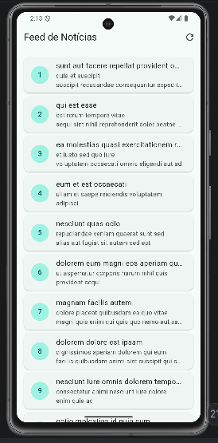
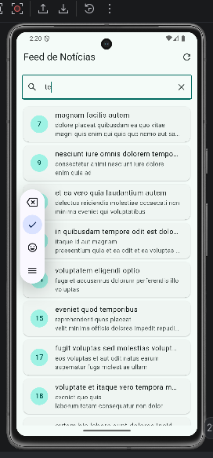
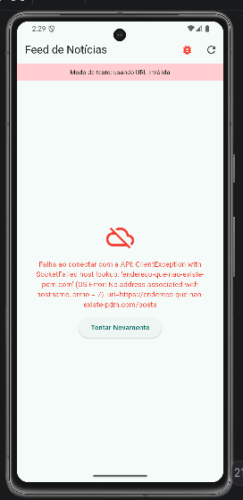

# Feed de Notícias — Consumo Avançado de APIs

Roteiro Prático da Aula 10 — Iteração de Listas JSON, StatusCode e Try/Catch
Programação para Dispositivos Móveis I · FATEC Matão · 2026/2

---

## Sobre o projeto

Aplicativo Flutter que consome uma lista dinâmica de dados remotos, valida a
resposta HTTP pelo `statusCode` e trata falhas de rede de forma defensiva com
`try / catch / finally`.

A interface cobre os quatro estados essenciais de uma tela conectada —
**Carregando**, **Sucesso**, **Vazio** e **Erro de Conexão** — seguindo o
princípio de que a tela nunca deve ficar em branco.

A fonte de dados é a API pública [JSONPlaceholder](https://jsonplaceholder.typicode.com),
no endpoint `/posts`, que retorna 100 registros com os campos `id`, `userId`,
`title` e `body`.

## Arquitetura

| Arquivo | Responsabilidade |
|---|---|
| `lib/models/noticia_model.dart` | Mapeia o JSON para objeto Dart tipado via factory `fromJson` |
| `lib/services/noticia_service.dart` | Requisição HTTP, validação de status e tratamento de exceções |
| `lib/screens/feed_noticias_screen.dart` | Gerencia os quatro estados e renderiza a lista |
| `lib/screens/detalhe_noticia_screen.dart` | Exibe a notícia completa recebida por construtor |
| `lib/main.dart` | Ponto de entrada e tema Material 3 |

## Do JSON ao objeto tipado

A conversão acontece em duas etapas. O `jsonDecode` transforma o texto da
resposta em `List<dynamic>` — uma lista de mapas brutos. Em seguida, o `.map`
passa cada mapa pelo factory e o `.toList()` materializa uma `List<NoticiaModel>`:

```dart
final List<dynamic> listaJson = jsonDecode(response.body);
return listaJson.map((json) => NoticiaModel.fromJson(json)).toList();
```

Depois dessa linha, o restante do aplicativo trabalha apenas com objetos
tipados. O modelo usa o operador `??` em todos os campos, de modo que uma
chave ausente ou nula na resposta não derruba a aplicação.

## Tratamento de exceções

O service separa dois tipos distintos de falha:

- **O servidor respondeu com erro** (404, 500) — o `if` valida
  `response.statusCode == 200` e dispara um `throw` quando a condição falha.
- **A requisição não chegou ao servidor** — sem internet, DNS inválido ou
  timeout. Nesse caso o próprio `http.get` lança, e o `catch` externo captura.

Na tela, o `finally` garante que `_carregando` volte a `false` em qualquer
desfecho. Se essa atribuição estivesse apenas no `try`, uma falha deixaria o
indicador de progresso girando indefinidamente.

## Funcionalidades

**Base do roteiro**

- Requisição HTTP com o pacote `http` e validação de `statusCode`
- `ListView.builder` renderizando os itens sob demanda
- `Card` + `ListTile` com id no `CircleAvatar` e texto truncado por `ellipsis`
- Botão de recarga na `AppBar`

**Desafio Básico — Filtro de busca local**

Campo de busca que filtra a lista por título em tempo real, sem nova
requisição. O filtro é um getter calculado sobre a lista original, então os
dados carregados permanecem intactos. A comparação usa `toLowerCase()` nos
dois lados, ignorando maiúsculas.

**Desafio Intermediário — Navegação para detalhes**

Toque no card abre a `DetalheNoticiaScreen` recebendo a instância completa de
`NoticiaModel` pelo construtor. Como os dados já estão em memória, não há nova
chamada de rede.

**Desafio Avançado — Simulação de erro de conexão**

Botão na `AppBar` que alterna o service para uma URL inválida e recarrega,
permitindo validar o estado de erro com o botão "Tentar Novamente" sem precisar
desligar a internet do dispositivo.

## Capturas de tela

### Lista carregada e filtro de busca

| Feed vindo da API | Filtro por título |
|:---:|:---:|
|  |  |

Os 100 registros são renderizados pelo `ListView.builder`, que constrói apenas
os itens visíveis. O filtro reduz a lista conforme o texto é digitado.

### Detalhes e estado de erro

| Notícia completa | Falha de conexão |
|:---:|:---:|
|  |  |

A tela de detalhes exibe o texto sem truncamento. O estado de erro mostra
ícone, mensagem e ação de recuperação.

## Testes

```bash
flutter test
```

Quatorze testes cobrem o projeto em três níveis:

- **Modelo** — mapeamento das chaves da API e valores padrão para campos
  nulos ou ausentes.
- **Service** — resposta 200 convertida em objetos, status de erro gerando
  exceção, falha de rede capturada, e verificação de que o modo de simulação
  realmente troca a URL. Os testes usam o `MockClient` do próprio pacote
  `http`, então rodam sem internet e de forma determinística.
- **Interface** — indicador de carregamento, renderização dos cards, estado
  vazio, estado de erro, filtro por título e navegação para os detalhes.

## Como executar

```bash
flutter pub get
flutter run
```

## Histórico de commits

```
feat: cria modelo e servico de noticias com tratamento de excecoes
feat: implementa FeedNoticiasScreen com ListView.builder e indicador de loading
feat: adiciona filtro de busca local por titulo
feat: navega para tela de detalhes passando objeto via construtor
feat: adiciona simulacao de erro de conexao para validar estado de falha
test: cobre modelo, servico com cliente falso e estados da tela
chore: adiciona estrutura base do projeto Flutter
docs: adiciona capturas de tela do app em execucao
```

## Tecnologias

Flutter · Dart · Material Design 3 · pacote `http`